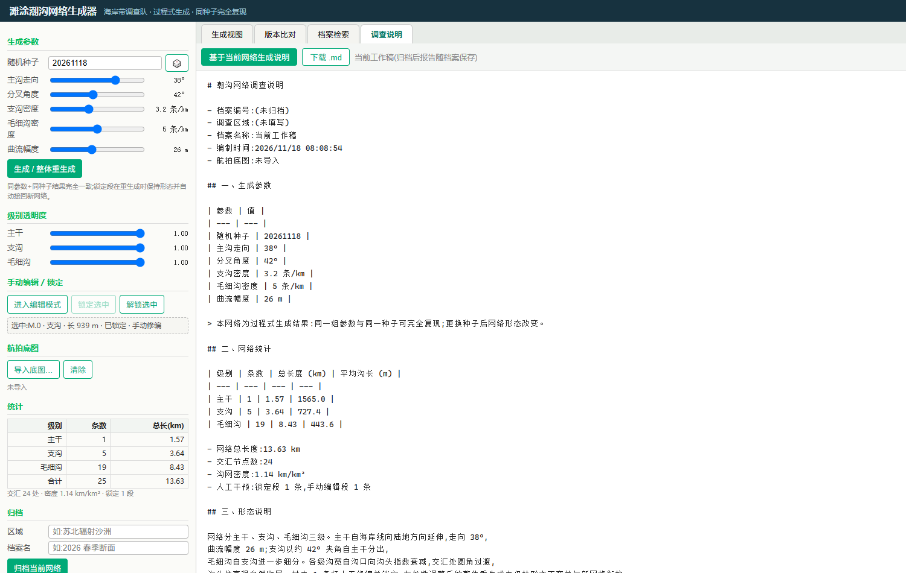

# 滩涂潮沟网络生成器

面向海岸带调查队的潮沟网络过程式生成工具。原生 TypeScript + Web Components + WebGPU,无任何前端框架。



## 运行

```bash
npm install
npm run build      # tsc 编译到 dist/
npm run serve      # http://localhost:8080(WebGPU 需要 localhost 或 https)
```

无 WebGPU 的环境自动回退 Canvas2D,功能一致。

## 测试

```bash
npm run verify     # 确定性 / 锁定段重接 单元验证(Node 直接跑编译产物)
npm run test:ui    # 全流程 UI 冒烟测试(驱动本机 Chrome,需先 npm run serve 起 8123 端口)
```

`test:ui` 默认连 `http://localhost:8123/`,可用 `node scripts/serve.cjs 8123` 起服务。

## 功能对照

| 需求 | 实现 |
| --- | --- |
| 输入主沟走向、分叉角度、支沟密度、曲流幅度、随机种子 | 左侧参数面板(另加毛细沟密度) |
| 同参数+同种子完全一致,换种子才变化 | `src/rng.ts`:mulberry32 + 整数哈希噪声,按 `hashStrings(seed, 路径id)` 派生子流,不用 `Math.random`/`Date`;`scripts/verify.mjs` 验证 |
| 主干/支沟/毛细沟三级,各级独立宽度衰减与弯曲噪声 | `src/generator.ts` 的 `LEVEL_CFG`(初始宽度、衰减系数、曲流缩放、噪声频率、收尾抬升) |
| 交汇处圆角过渡 | 子沟入口 5 步沿父沟切线平滑转向 + 渲染时每折点圆盘(`src/geometry.ts`) |
| 沟头按高程自然收尾 | `src/elevation.ts` 过程式高程场;沟头越过「起点高程+该级允许抬升」时插值终止,末端 15% 宽度渐缩 |
| 手动修改可锁定,重生成时形态不变并接回新网络 | 编辑模式点选/拖顶点/双击加点 → 锁定;`applyLocked()` 保留锁定段几何,贝塞尔连接段接回最近同级/上级沟,原子沟重接 |
| WebGPU 绘制,平移缩放,按级别调透明度 | `src/renderer-webgpu.ts` 单 draw call 三角网格,uniform 携带三级透明度;滚轮缩放/拖拽平移 |
| 按沟长和密度分级配色 | `assignColors()`:同级内沟越长色越深,网格局部密度越高色越暖 |
| 导入航拍底图 | 文件导入 → ImageBitmap 纹理(WebGPU)/ drawImage(回退),随档案存入 IndexedDB |
| 编号档案 | `TCN-YYYY-NNN` 年内递增编号,IndexedDB 持久化(参数+网络+底图+报告) |
| 生成结果与历史版本并排比对 | 「版本比对」页双视口相机联动 + 参数/统计差异表 |
| 调查说明 | 「调查说明」页自动生成 Markdown 报告,可下载 .md,归档时随档案保存 |
| 按年份/区域/沟级别检索 | 「档案检索」页三条件过滤 |

## 目录结构

```
src/
  types.ts            共享类型
  rng.ts              确定性随机流与噪声(可复现性的根基)
  elevation.ts        过程式高程场(海岸线 + 坡降 + 分形微地形)
  generator.ts        三级潮沟生成、锁定段重接、统计与配色
  geometry.ts         折线三角化(圆角连接/圆盘)、拾取
  renderer-webgpu.ts  WebGPU 渲染器
  renderer-2d.ts      Canvas2D 回退渲染器
  db.ts               IndexedDB 档案库与检索
  report.ts           调查说明生成
  state.ts            应用状态(事件总线)
  components/         Web Components:视口、参数面板、比对、档案、报告、外壳
scripts/
  verify.mjs          确定性验证
  ui-test.mjs         UI 全流程冒烟测试
  serve.cjs           零依赖静态服务器
```
